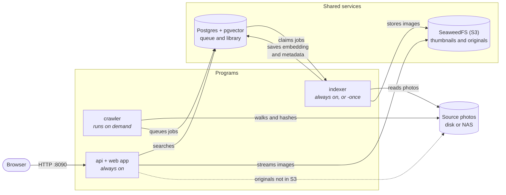
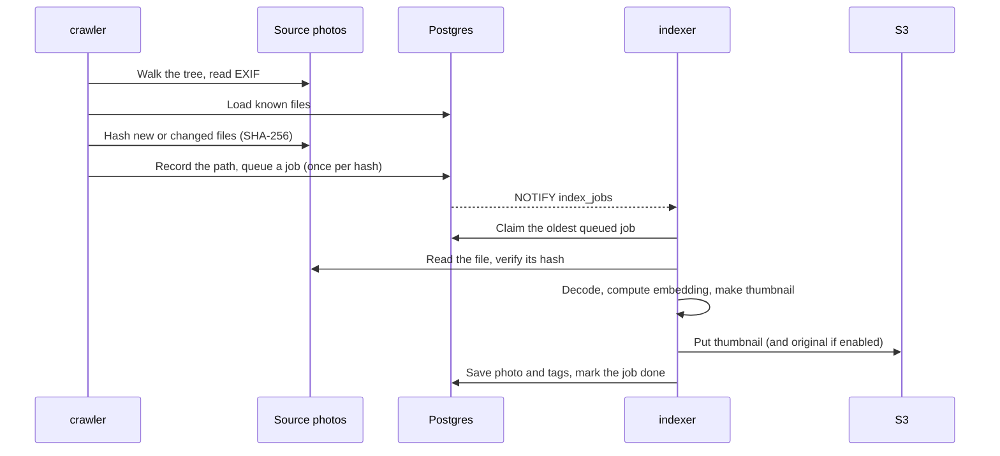
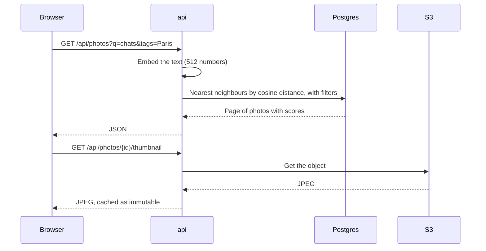
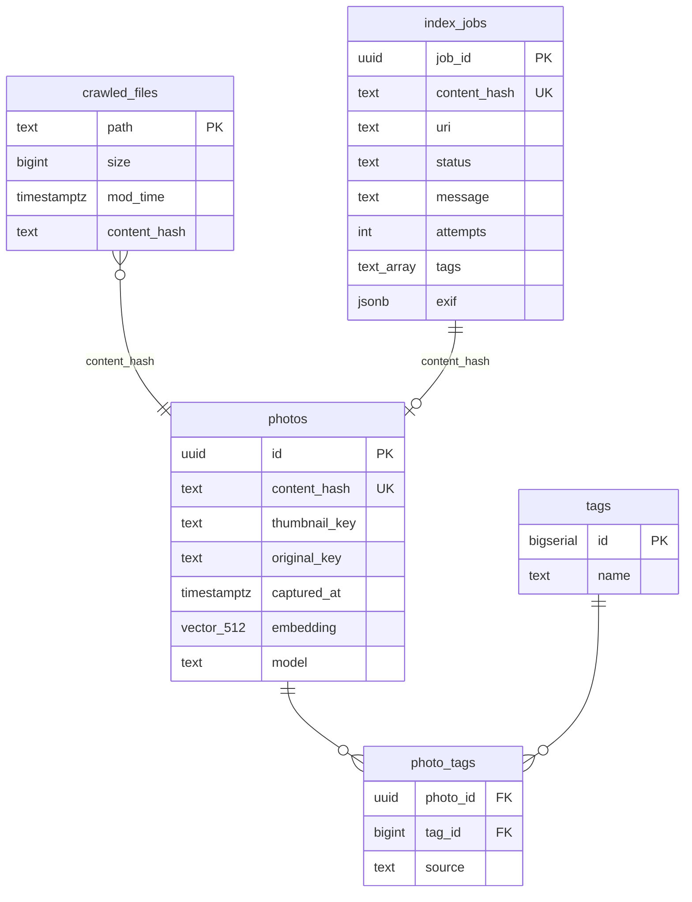
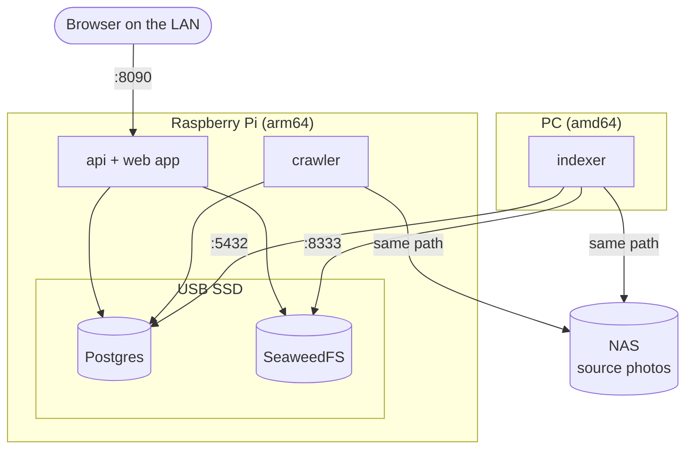

# Photo album

A self-hosted photo library for pictures scattered across disks and applications. It indexes them
with CLIP so you can find photos by describing them, in English, French and 50+ other languages,
without tagging anything first.

- **Search by text** ("deux chats sur un canapé"), **by an uploaded picture**, or with **"more like
  this"**, combined with tag and date filters.
- **Browse by date**, grouped by year, and tag photos one at a time or in bulk. Folder names become
  tags automatically.
- **Split the work across machines:** the library can live on a Raspberry Pi while a stronger PC does
  the indexing whenever it's on.

**Contents:** [Architecture](#architecture) · [Quick start](#quick-start) ·
[Raspberry Pi + PC](#raspberry-pi--pc) · [Configuration](#configuration) ·
[Development](#development) · [SeaweedFS](#seaweedfs)

## Architecture

### Overview

Three programs written in Go cooperate through two shared services. They never call each other
directly: Postgres holds the job queue and the library, and S3 storage holds the image files.



| Component | What it does | CLIP model loaded | Needs |
|---|---|---|---|
| **crawler** ([`cmd/crawler`](phalbum/cmd/crawler)) | Finds images, hashes new or changed files, queues one job per unique content | None | Postgres, photos |
| **indexer** ([`cmd/indexer`](phalbum/cmd/indexer)) | Turns jobs into searchable photos: embedding, thumbnail, metadata, tags | Image encoder | Postgres, S3, photos |
| **api** ([`cmd/api`](phalbum/cmd/api)) | Serves the REST API and the web app from one process | Text encoder and image encoder | Postgres, S3, and photos unless originals are in S3 |
| **web app** ([`phalbum/web`](phalbum/web)) | Browser UI, embedded into the `api` binary at build time | None | The API |
| **Postgres + pgvector** | Job queue, library, tags and the vector index | | |
| **SeaweedFS** | S3-compatible storage for thumbnails and, optionally, originals | | |

### Indexing a photo



1. **Crawl.** The crawler walks the tree, keeping files with an image extension (`jpg`, `png`, `gif`,
   `webp`, `bmp`, `tiff`, `heic`, `avif`). A file whose path, size and modification time match the last
   crawl is skipped without being read, which makes repeat crawls fast. Icons and thumbnails, meaning
   images whose longest side is under 400 px (`-min-size`), are skipped, and so are hidden folders and
   files and the caches NAS systems and macOS create, such as `@eaDir` and `__MACOSX`. The folders between the crawl
   root and a file become its tags.
2. **Queue.** Every 100 images found, the walk pauses to hash and queue them, so jobs appear during the
   crawl and an interrupted crawl keeps what it has queued. Each new file is recorded in `crawled_files`
   and queued in `index_jobs`. Jobs are unique
   per SHA-256 content hash, so a photo copied to several folders is indexed once and remembers all its
   paths.
3. **Claim.** The indexer takes the oldest queued job. A Postgres `NOTIFY` wakes it immediately, and it
   also polls once a minute in case a notification is missed. Several indexers could safely run at
   once.
4. **Process.** The indexer reads the file and rejects it if its content changed since the crawl. It
   then decodes it, applying the EXIF orientation, and shrinks a working copy to 512 px on the short
   side. If a JPEG's main image is corrupt, it falls back to the largest embedded preview. From that
   copy it computes the embedding and a 512 px JPEG thumbnail.
5. **Store.** The thumbnail goes to S3, plus the original when `STORE_ORIGINALS` is on. The embedding,
   EXIF-derived metadata (date, camera, GPS) and tags go to Postgres.

The queue is what lets the indexer live elsewhere: while it's off, jobs just wait.

### Searching



- **One shared vector space.** Text and images are embedded into the same 512-dimensional space, so a
  sentence and a photo that mean the same thing end up close together. Search is a nearest-neighbour
  lookup.
- **Combined queries.** Text, an uploaded picture and "more like this" can be used together: their
  vectors are averaged and renormalized into one query. "More like this" uses the stored embedding, so
  it needs no model.
- **Filters and ordering.** pgvector's HNSW index finds candidates, and iterative scanning keeps it
  searching until enough rows pass the tag and date filters. Candidates are then sorted by exact
  distance. Without a query vector, photos are listed by date.
- **Dates.** `captured_at` is the EXIF date, falling back to the file's modification time, so photos
  without EXIF can still be browsed and filtered.
- **Originals.** The API streams from S3 if the original was stored there. Otherwise it tries each
  known source path on disk.
- **Serialized inference.** Embedding calls run one at a time in each API process, which keeps memory
  predictable on small machines.

### Embedding models

Models run in-process through [ONNX Runtime](https://onnxruntime.ai/) via
[`onnxruntime_go`](https://github.com/yalue/onnxruntime_go), with no Python at runtime. The tokenizers
are implemented in pure Go in [`internal/embedding`](phalbum/internal/embedding).
[`scripts/fetch-models.sh`](phalbum/scripts/fetch-models.sh) downloads quantized models for the target
CPU.

| Role | Model | Details |
|---|---|---|
| Images | [`Xenova/clip-vit-base-patch32`](https://huggingface.co/Xenova/clip-vit-base-patch32) | OpenAI CLIP ViT-B/32, 224 px input |
| Text, multilingual (default in Docker) | [`sentence-transformers/clip-ViT-B-32-multilingual-v1`](https://huggingface.co/sentence-transformers/clip-ViT-B-32-multilingual-v1) | DistilBERT with mean pooling and a 768→512 projection, both run in Go |
| Text, English only (default outside Docker) | `Xenova/clip-vit-base-patch32` | CLIP's own text encoder |

The multilingual encoder was trained to match the CLIP image encoder's vector space. That's why the
text model can be swapped without reindexing a single photo, and it's the one model choice that can be
changed so cheaply. Changing the *image* model means reindexing everything, because stored embeddings
are only comparable with vectors from the same space. Each photo records its model in `photos.model`
to make that possible later.

### Data model

Each program applies its own idempotent schema at startup, under an advisory lock so that programs
starting together don't race. There is no separate migration step.



The diagram shows the main columns only. See the [jobs](phalbum/internal/jobs/schema.sql) and
[library](phalbum/internal/library/schema.sql) schemas for the rest.

- **Identity is the content hash.** The same bytes are one photo, however many paths they have.
- **Job status** moves `queued` → `processing` → `success` or `error`, with the reason in `message`.
- **Tag `source`** records where a tag came from: `path` (folder names), `user`, or `auto`. Tag names
  are unique regardless of case.
- **Object keys** use the first two hash characters as a prefix:
  `thumbnails/ab/abcdef….jpg` and `originals/ab/abcdef….jpg`. Because content never changes under a
  key, the API can serve images as cacheable forever.

### REST API

The contract is [`phalbum/api/openapi.yaml`](phalbum/api/openapi.yaml), and the web app's types are
generated from it. Everything is under `/api`:

| Endpoint | Purpose |
|---|---|
| `GET /health` | Liveness: the database is reachable |
| `GET /photos` | List or search: `q`, `similar_to`, `tags`, `from`, `to`, `sort`, `limit`, `offset` |
| `POST /photos/search` | Search with an uploaded picture, up to 20 MB, plus the same filters |
| `GET /photos/{id}`, `/thumbnail`, `/original` | A photo's details and images |
| `POST /photos/{id}/tags`, `DELETE /photos/{id}/tags/{tagID}` | Tag or untag one photo |
| `POST /photos/tags` | Tag several photos at once |
| `GET /years` | Photo counts per year, for the year jump bar |
| `GET`/`POST /tags`, `PATCH`/`DELETE /tags/{id}` | Manage tags |

### Web app

A static single-page app in React 19, built with Vite, Tailwind CSS v4 and shadcn/ui, using TanStack
Query for data and wouter for routing. `npm run build` writes `web/dist`, which is embedded in the
`api` binary with `go:embed`, so one process serves both on the same origin.

- All search filters live in the URL, so any search can be bookmarked or shared.
- Select several photos by long-pressing on touch, or with the check mark or shift-click on desktop.
- Tags are managed at `/tags`. `/admin` is reserved for a future administration UI.

### Deployment layouts

Because the programs only meet in Postgres and S3, where each one runs is a deployment choice:

| | Single machine | Raspberry Pi + PC |
|---|---|---|
| Compose files | [`docker-compose.local.yml`](docker/docker-compose.local.yml) | [`docker/rpi`](docker/rpi/docker-compose.yml) and [`docker/pc`](docker/pc/docker-compose.yml) |
| Postgres, SeaweedFS, api, crawler | This machine | Raspberry Pi |
| Indexer | This machine | PC, reaching the Pi over the LAN |
| Source photos | Local folders | NAS, mounted on both |
| SeaweedFS | Separate containers, anonymous access, plus webdav, Prometheus and Adminer | One process, access keys, tuned for 1 GB of RAM |
| Originals in S3 | Off by default | On, copied to the Pi's SSD |



**The same-path rule.** The crawler stores absolute `file://` paths, and the indexer later opens exactly
those paths. So every container mounts `PHOTOS_ROOT` at the same path it has on the host, and all
machines must mount the NAS at the same location.

### Failure handling

| Situation | What happens |
|---|---|
| Indexer stopped or PC off | Jobs wait in the queue, and search and browsing keep working |
| Indexer dies mid-job | The job stays `processing`. When an indexer next starts, jobs older than 10 minutes are requeued |
| A job fails (bad file, storage down) | The job is marked `error` with the reason and is not retried automatically. Requeue with `indexer -retry-failed` |
| A file changes between crawl and indexing | The job fails with "content changed since crawl". The next crawl queues the new content |
| Database unreachable at startup | The program exits, and the Docker restart policy retries it |
| Lost connection while waiting for jobs | The indexer reconnects its listener on its own |
| A thumbnail or stored original is missing or corrupted in SeaweedFS | The api serves the original from the source file and rebuilds the thumbnail from it, then writes both back. `scrub` finds and repairs them all. See [Corrupted objects](#corrupted-objects) |
| Any connectivity doubt | Run `-check` on the affected program. See [Check the connections](#check-the-connections) |

### Limitations

- **No login.** Anyone who can reach the web app can view and edit the library, so don't expose it to
  the internet.
- **No encryption in transit.** Postgres and S3 traffic is unencrypted. That's for a trusted LAN only;
  use a VPN across networks.
- **HEIC and AVIF aren't decoded yet.** The crawler finds them, but their jobs fail with "unsupported
  format".
- **Deleting a source file doesn't remove its photo** from the library.
- **`STORE_ORIGINALS` isn't retroactive.** It only applies to photos indexed after it's turned on.

### Code layout

```text
phalbum/
├── cmd/
│   ├── api/          HTTP server for the API and web app
│   ├── crawler/      Walks folders and queues jobs
│   ├── indexer/      Processes the queue
│   ├── scrub/        Checks every stored object, rebuilds broken ones
│   └── clipdemo/     Tries the models on one image from the command line
├── internal/
│   ├── api/          HTTP handlers and middleware
│   ├── crawler/      Directory walking, MIME and EXIF detection, hashing
│   ├── embedding/    ONNX inference, tokenizers, image preprocessing
│   ├── health/       The -check connectivity report
│   ├── imaging/      Decoding, orientation, thumbnails
│   ├── indexer/      The job pipeline
│   ├── jobs/         The queue (owns its schema)
│   ├── library/      Photos, tags and search (owns its schema)
│   ├── repair/       Rebuilds thumbnails and originals from source files
│   ├── settings/     Configuration from the environment and .env
│   └── storage/      S3 client
├── api/openapi.yaml  API contract
├── scripts/          Model download
├── web/              React app
└── Dockerfile        One image with api, indexer, crawler and scrub
docker/               Compose files and example settings
```

## Quick start

This runs everything on one machine with Docker. Create `phalbum/.env` with `POSTGRES_USER`,
`POSTGRES_PASSWORD` and `POSTGRES_DB`, then:

```sh
cd docker
docker compose -f docker-compose.local.yml up -d --build
docker compose -f docker-compose.local.yml run --rm crawler $HOME/Pictures   # queue a folder
```

Open http://localhost:8090. The first start downloads the models into a volume, which takes a while.

The folder must be under `PHOTOS_ROOT`, which defaults to your home directory. The local compose file
reads these from the environment or a `docker/.env` file:

| Variable          | Default   | Meaning                                                           |
|-------------------|-----------|-------------------------------------------------------------------|
| `PHOTOS_ROOT`     | `$HOME`   | Folder tree the containers can read photos from                   |
| `PHOTOS_UID/GID`  | `1000`    | User the containers run as; must be able to read the photos       |
| `STORE_ORIGINALS` | `false`   | Copy originals into SeaweedFS, so they're served without the disk |

## Raspberry Pi + PC

This layout is for a Raspberry Pi 3 (1 GB of RAM). See [Deployment layouts](#deployment-layouts) for
what runs where.

The Pi publishes ports `8090` (web), `5432` (Postgres) and `8333` (S3). While the PC is off, search
keeps working and new jobs wait in the queue. Keep all of this on a trusted LAN, and don't forward
these ports to the internet.

### Prepare the machines

- **64-bit OS on the Pi:** `uname -m` must print `aarch64`.
- **SSD on the Pi:** format it as ext4 (Postgres needs Unix permissions, so not exFAT or NTFS) and
  mount it from `/etc/fstab`. It must hold the whole photo library, because originals are copied to
  it. It may need a powered USB hub or a low-power enclosure, and it's worth adding a swap file
  there as a safety margin.
- **Docker's data on the SSD:** set `data-root` in `/etc/docker/daemon.json` to a folder on the SSD,
  because Docker's volumes live there. Otherwise the database and copied photos fill the SD card.
- **NAS on both machines:** mount it from `/etc/fstab` **at the same path**, because of the
  [same-path rule](#deployment-layouts). It must be mounted before Docker starts, or a container can
  bind an empty directory.
- **Pi address:** give it a static IP or DHCP reservation.

### Build and push

All three programs share one image, and each compose service chooses its binary with `entrypoint`. The
models aren't in the image: at startup, a short-lived `models` service downloads any missing files into
a volume. Nothing is built on the Pi.

On the PC, in `phalbum/`, replacing `myuser` with your Docker Hub username:

```sh
# Lets this PC build for arm64. Needed once after each reboot.
docker run --privileged --rm tonistiigi/binfmt --install arm64

# Build
docker build -t phalbum:amd64 .
docker build --platform linux/arm64 -t phalbum:arm64 .

# Tag
docker tag phalbum:amd64 myuser/phalbum:amd64
docker tag phalbum:arm64 myuser/phalbum:arm64

# Push
docker login
docker push myuser/phalbum:amd64
docker push myuser/phalbum:arm64
```

A repository Docker Hub creates on push is public by default. The image holds no credentials, because
`.env` files are excluded from the build. If you make it private, run `docker login` on the Pi too.

### Start the services

Each machine has one folder with a `docker-compose.yml` and a `.env.example`. Compose reads `.env` from
the same folder. `.env` sets the image, where the database and storage are, and the credentials, which
must match on both machines.

On the Pi, after copying the folder with `scp -r docker/rpi user@pi:phalbum`:

```sh
cd phalbum
cp .env.example .env            # then edit it
docker compose pull
docker compose up -d
```

On the PC:

```sh
cd docker/pc
cp .env.example .env            # then edit it
docker compose pull
docker compose up -d
```

Then queue a folder from the Pi:

```sh
docker compose run --rm crawler /mnt/photos/some-folder
```

To release a new version, build, tag and push again, then repeat `docker compose pull` and
`docker compose up -d` on both machines.

### Data

Everything is kept in Docker volumes, which survive `docker compose down` and new image versions:

| Volume | Machine | Holds |
|---|---|---|
| `db-data` | Pi | The Postgres database |
| `seaweedfs-data` | Pi | Thumbnails and copied photos |
| `models` | Pi and PC | ONNX Runtime and the models for that machine's architecture |

### Check the connections

Each binary has a `-check` flag that tests its own links, from where it runs, and exits non-zero if
any fail. It only reads, so it's safe to run at any time.

```sh
# On the PC, in docker/pc: Postgres and S3 on the Pi, the NAS mount, the model files
docker compose run --rm indexer -check

# On the Pi, once the stack is up
docker compose run --rm --no-deps api -check
docker compose run --rm --no-deps crawler -check
```

### Corrupted objects

SeaweedFS checks a checksum on every read. If the disk returned bad data, its log shows `invalid CRC
for needle … data on disk corrupted`, and the read fails after several seconds of retries. The api
copes with this on its own: it rebuilds the thumbnail from the source file, or serves the original
from there, and writes the object back. To check and repair everything in one pass:

```sh
# in docker/pc on the PC
docker compose run --rm scrub -dry-run   # list broken objects
docker compose run --rm scrub            # rebuild them from the photos
```

Flags: `-only thumbnails|originals`, `-concurrency 1`, `-timeout 1m`. An object can't be repaired
when its source file is gone, or has changed since it was indexed.

Rebuilding hashes and decodes photos, which is too much for a Pi 3 next to the api. Run scrub from
the PC instead (`docker compose run --rm scrub` in `docker/pc`): it reaches Postgres and S3 on the
Pi and reads the photos from the NAS.

Corruption on a USB disk usually means the disk link is failing. Look for resets in `dmesg -T | grep
-iE 'uas|reset|I/O error'`. If UAS resets show up, add `usb-storage.quirks=<VID>:<PID>:u` (from
`lsusb`) to `/boot/firmware/cmdline.txt` and reboot. Also check the power supply, or use a powered
hub, and check the disk with `smartctl -a -d sat /dev/sdX`.

### What to expect on a Pi 3

The SSD and the network share one USB 2.0 bus, so the first crawl and copying originals will be slow.
Searches also take longer than on a PC.

If the api runs out of memory, set `CLIP_DISABLE_VISION=true` in `.env`. That only disables
searching by an uploaded picture. Text search and "more like this" keep working.

If jobs fail, for example because the Pi was unreachable or restarting, queue them again from the PC:

```sh
cd docker/pc
docker compose run --rm indexer -retry-failed -once
```

## Configuration

All programs read the environment, optionally seeded from a `.env` file in the current or parent
directory. Values already in the environment win.

| Variable | Default | Used by | Meaning |
|---|---|---|---|
| `DATABASE_URL` | | all | Full connection string; overrides `POSTGRES_*` |
| `POSTGRES_USER`, `POSTGRES_PASSWORD` | | all | Database credentials |
| `POSTGRES_DB` | `postgres` | all | Database name |
| `POSTGRES_HOST`, `POSTGRES_PORT` | `localhost`, `5432` | all | Database address |
| `S3_ENDPOINT` | `http://localhost:8333` | api, indexer | SeaweedFS S3 address |
| `S3_REGION`, `S3_BUCKET` | `us-east-1`, `photos` | api, indexer | The bucket is created if missing |
| `S3_ACCESS_KEY`, `S3_SECRET_KEY` | | api, indexer | Empty means anonymous access |
| `STORE_ORIGINALS` | `false` | indexer | Also copy originals to S3 |
| `PHOTOS_ROOT` | | `-check` | Photos folder to verify |
| `ONNX_LIB` | `models/libonnxruntime.so.1.31.0` | api, indexer | ONNX Runtime library |
| `CLIP_MODELS_DIR` | `models/clip-vit-base-patch32` | api, indexer | CLIP model files |
| `CLIP_TEXT_MODELS_DIR` | | api | Multilingual text model; empty uses CLIP's English one. The Docker image sets it |
| `ONNX_THREADS` | `0` (automatic) | api | ONNX Runtime threads |
| `CLIP_DISABLE_VISION` | `false` | api | Don't load the image encoder, saving memory; disables searching by a picture |
| `API_ADDR` | `:8090` | api | Listen address |
| `CORS_ORIGINS` | `*` | api | Allowed origins, comma-separated |

## Development

Requires Go 1.25, and Node 20.19+ (see `phalbum/web/.nvmrc`) for the web app.

```sh
cd phalbum
scripts/fetch-models.sh   # download ONNX Runtime and the models into models/
make api                  # npm ci, build the web app, then go build -o bin/api ./cmd/api
make dev-web              # Vite on http://localhost:5173 with hot reload; proxies /api to :8090
make gen-api              # regenerate web/src/api/schema.d.ts after changing api/openapi.yaml
make test                 # Go tests and the web typecheck
```

Without a web build, the API still works, and `/` answers 503 with a hint to build the app. Tests that
need the model files or a real service skip themselves when those aren't available.

## SeaweedFS

This is the storage layer. MinIO would be the usual choice, but that project was archived in May 2026.
[SeaweedFS](https://github.com/seaweedfs/seaweedfs) is open source, written in Go, and follows the same
ideas as Facebook's Haystack: it separates the data and metadata paths to make disk access O(1).

It has these components:

1. **Master:** holds the volume-to-server mappings, small enough to be cacheable and quick.
1. **Volume servers (one or more):** store the blob data and per-blob metadata.
1. **Filer (optional):** exposes a POSIX-like filesystem abstraction.
1. **S3 gateway:** the S3 API this project talks to, on top of the filer.

More information at
[DeepWiki - SeaweedFS overview](https://deepwiki.com/seaweedfs/seaweedfs/1.1-architecture-overview).
